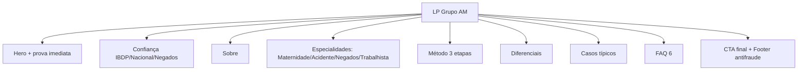

# Grupo AM Jurídico UI/UX Specification
Versão 1.0 — 2026-10-14 — YOLO a partir do briefing + `index.html` existente

## 1. Introduction
LP de alta conversão para benefícios previdenciários/trabalhistas com atendimento nacional via WhatsApp. Fundação para design e dev front-end.

### Overall UX Goals & Principles
**Personas:** Mariana gestante CLT; Carlos acidentado sequela leve; Lúcia BPC negado (ver `outputs/ux-research/personas.md`).
**Usability Goals:** entender elegibilidade em <2min; contatar em 1 clique com mensagem pronta; confiar no canal oficial; ler sem CLS em 360-1600px.
**Principles:** 1 Clareza sobre categoria antes de tese 2 Prova antifraude visível 3 Individual antes de genérico 4 Acessível por padrão 5 Sem promessa de resultado.

| Date | Version | Description | Author |
|---|---|---|---|
| 2026-10-14 | 1.0 | Spec YOLO inicial da LP | Uma |

## 2. Information Architecture

**Primary Nav:** Especialidades | Sobre | Como atuamos | FAQ + CTA WhatsApp. **Secondary:** âncoras por seção + voltar ao topo. **Breadcrumbs:** N/A (one-pager).

## 3. User Flows
**Fluxo principal — pedir análise:** Goal: enviar caso no WA. Entry: qualquer CTA. Passos: clica CTA -> abre wa.me com texto do benefício -> envia relato/fotos -> recebe análise 1 dia útil. Success: conversa iniciada. Edge: foto ilegível/CNIS ausente/número falso (ver flows-inventory). Notes: 4 textos pré-preenchidos distintos por seção para atribuição.

## 4. Wireframes & Mockups
**Primary Design Files:** `index.html` (referência viva) + `outputs/wireframes/wireframe-lofi.md`.
Key screens: Hero 2col->1col; Bento especialidades; Timeline; FAQ; CTA. Interações: reveal stagger, accordion exclusivo, WA contextual, toggle tema persistido.

## 5. Component Library
Approach: tokens próprios, sem framework; futura migração para tokens DTCG.
Core: Button primary/outline/light/sm; Badge; Proof card; Timeline step; FAQ item; WA float; Cookie bar; Progress; Theme toggle. States: todos com focus-visible + active .97.

## 6. Branding & Style
| Color Type | Hex | Usage |
|---|---|---|
| Primary | #1A2B4C | superfícies, bento destaque |
| Dark | #0F1A2E | hero/sobre/casos/CTA/footer |
| Accent | #C5A880 | CTAs, selos, foco |
| Success | #1FA855 | só botão WA flutuante |
| Error | #C55050 translúcido | só bloco antifraude |
| Neutral | #F9F9FB/#FFFFFF/#22252A/#68707C | fundo/texto/borda #E3E0D6 |
Fonts: Playfair Display 600/700 títulos (clamp 2.1-3.4rem hero); Inter 400/500 corpo 18px/1.6. Ícones: Feather SVG outline 2px currentColor. Grid: 1280 container, 12/8/4 col; spacing 8-96; radius máx 12; sombra sm/md.

## 7. Accessibility
Standard: WCAG 2.2 AA. Visual: contraste ≥4.5, foco ouro 2px offset 3, texto redimensionável via clamp. Interação: teclado total (menu/accordion), ESC fecha, skip-link, sem dependência de hover. Conteúdo: 1 h1, hierarquia sem salto, alt descritivo, labels ARIA. Teste: teclado + leitor + Lighthouse A11y 100 + reduced-motion.

## 8. Responsiveness
| Breakpoint | Min | Max | Target |
|---|---|---|---|
| Mobile | 360 | 767 | 4col, hamburger, WA circular |
| Tablet | 768 | 1023 | 8col, hero 1col foto 16/10 |
| Desktop | 1024 | 1599 | 12col hero 2col |
| Wide | 1600 | - | container 1280 central |
Layout/nav/conteúdo/interação adaptam sem overflow horizontal; fontes fluidas sem media query de font-size.

## 9. Animation
Principles: Linear-like, sem bounce/rotação; 500-900ms; propósito (hierarquia/feedback). Key: reveal 700ms expo; stagger 60ms; hover card 500ms quart; ripple/botão; contador n/a (sem fake numbers); cursor desktop; blur-in hero.

## 10. Performance
Goals: LCP <2.5s, INP <200ms, CLS 0. Strategies: arquivo único, critical inline, hero eager fetchpriority high + resto lazy, aspect-ratio, content-visibility, preconnect fonts, sem vídeo/GIF.

## 11. Next Steps
1. Preencher OAB/endereço/redes oficiais 2. Captar 3 depoimentos autorizados 3. Revisar com stakeholders 4. Handoff para @dev com este spec + ai-prompt.
Handoff checklist: flows ok; inventory ok; a11y definido; responsivo claro; brand ok; perf ok.
